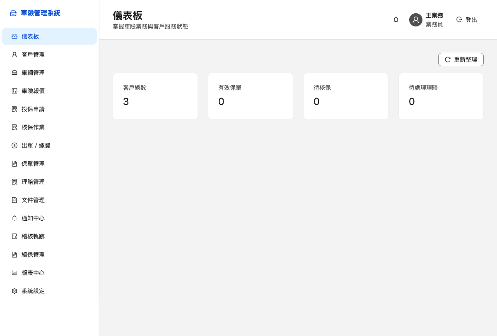
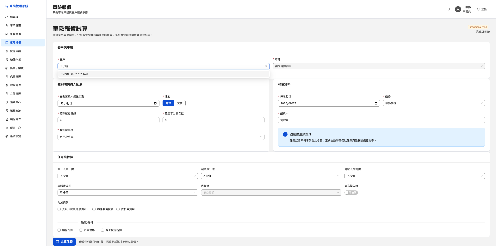
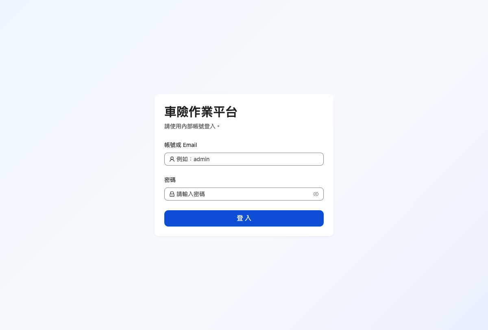
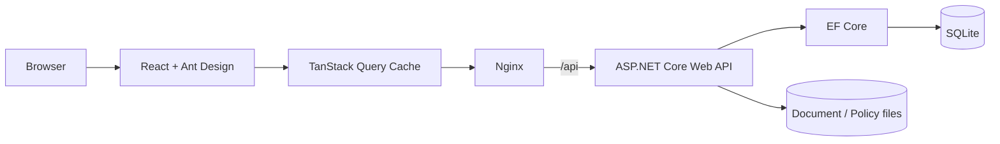

# 車險管理系統 Demo

一套可實際操作的車險業務流程 Demo。以前後端分離架構串起 **報價 → 投保 → 核保 → 繳費／出單 → 保單 → 理賠與後續管理**，並包含登入、MFA、角色權限、稽核與自動化測試。

> ⚠️ 本專案僅供作品展示、學習與測試。Seed Data、登入資料與費率皆為 Demo 用途，不得用於真實保險業務。

目前版本：[V0.1.1.0](https://github.com/isbrian/Car-insurance-template-public/releases/tag/0.1.1.0)

## 畫面預覽

### 儀表板



### 車險報價



### 登入



## 主要功能

| 模組 | Demo 內容 |
|---|---|
| 登入與權限 | 帳密登入、固定 Demo MFA、JWT、RBAC 多角色權限 |
| 客戶／車輛 | 客戶與車輛資料管理、敏感資訊遮罩 |
| 車險報價 | 強制險與任意險保障、從人因素、折扣、逐項保費拆解 |
| 投保申請 | 要保／被保險人、受益人、電子簽名、文件確認與送件 |
| 核保 | 核保規則命中、人工審查、核准流程 |
| 繳費／出單 | 繳費資訊、收款確認、產生保單 |
| 保單 | 案件追溯、敏感資料遮罩、保單 PDF／SHA-256 metadata |
| 後續作業 | 理賠、文件、通知、續保、稽核軌跡與管理功能 |

## 技術架構

- **Frontend**：React 19、TypeScript、Ant Design 5、TanStack Query 5、Vite
- **Backend**：ASP.NET Core Web API（.NET 10）、EF Core
- **Database**：SQLite
- **Web / Proxy**：Nginx
- **Testing**：xUnit、Playwright（含 E2E／Accessibility regression）
- **Runtime**：Docker Compose



瀏覽器只需連到 Web；Nginx 將 `/api/` reverse proxy 到 Compose network 內的 API，因此一般 Demo 不需要另外暴露 API host port。

前端以 TanStack Query 管理 server state、cache invalidation 與重新整理流程，並使用 route-level lazy loading 與 vendor chunk splitting 降低初始載入成本。

## V0.1.1.0 更新重點

- 導入 TanStack Query，取代主要頁面的手動遠端資料載入與 reload counter。
- 統一 Query keys、API error handling，以及登出／`401 Unauthorized` 時的 cache 清理。
- 導入 route-level lazy loading，拆分 React、TanStack Query 與 rc-components vendor chunks。
- production build 最大 chunk 由約 850 kB 降至 359.90 kB，不再出現 Vite 500 kB chunk 警告。
- 更新高風險相依套件；`npm audit` 為 0 vulnerabilities。
- 改善 Docker 跨架構相容性與 Playwright E2E selector 穩定性。
- 移除 repository 內的 runtime SQLite database；啟動時由 migration 與 Seed Data 建立 Demo 資料。

完整異動請見 [V0.1.1.0 Release Notes](https://github.com/isbrian/Car-insurance-template-public/releases/tag/0.1.1.0)。

## 快速開始

### 前置需求

- Docker Desktop，或相容的 Docker Engine + Docker Compose

在 repository root 執行：

```bash
docker compose -p car-insurance up --build -d
```

啟動後：

- Web：`http://localhost:8081/`
- API health：`http://localhost:8081/api/health`

確認服務：

```bash
docker compose -p car-insurance ps
```

停止服務：

```bash
docker compose -p car-insurance down
```

## Demo 帳號

所有帳號的公開 Demo 密碼皆為 `Demo123!`，MFA 驗證碼為 `123456`。

| Username | 角色 |
|---|---|
| `sales` | 業務員 |
| `underwriter` | 核保員 |
| `claims` | 理賠員 |
| `manager` | 主管 |
| `admin` | 系統管理員 |

固定密碼與 MFA 是為了讓公開 Demo 容易重現，**不是 production security design**。

## 建議 Demo 路線

1. 以 `sales` 登入並完成 MFA。
2. 在「車險報價」選擇 Seed Data 客戶／車輛並試算。
3. 由報價建立投保申請並送出。
4. 改以 `underwriter` 登入，檢視規則命中並完成核保。
5. 完成繳費／出單，在保單管理查看案件追溯與保單文件。

## 測試

### Frontend

本機 Node.js 基準版本記錄於 `.nvmrc`（Node.js 22.23.2）；GitHub Actions 使用 Node.js 22 major。

```bash
npm --prefix web ci
npm --prefix web run lint
npm --prefix web run typecheck
npm --prefix web run build
```

### API

需要 .NET 10 SDK：

```bash
dotnet test tests/CarInsurance.Api.Tests/CarInsurance.Api.Tests.csproj
```

### 完整 E2E

```bash
npm --prefix web run e2e:docker
```

E2E runner 使用獨立的 `docker-compose.e2e.yml` 與 SQLite volume，在 Playwright 官方 image 執行測試，結束後清除隔離環境，不會覆寫一般 Demo 資料。

V0.1.1.0 發布驗證結果：

- API integration tests：163/163 通過
- Playwright Docker E2E：18/18 通過
- ESLint、TypeScript typecheck、Vite production build：通過
- npm audit：0 vulnerabilities
- Gitleaks Git history／filesystem：無未處理洩漏

## 專案結構

| 路徑 | 說明 |
|---|---|
| `web/` | React + TypeScript 前端與 Playwright E2E |
| `web/src/query/` | TanStack Query client 與集中式 query keys |
| `api/` | ASP.NET Core Web API、EF Core、Seed Data 與暫定費率資料 |
| `tests/CarInsurance.Api.Tests/` | API integration tests |
| `screenshots/` | GitHub README 使用的實際 Demo 畫面 |
| `docker-compose.yml` | 一般 Demo 環境 |
| `docker-compose.e2e.yml` | 隔離 E2E 環境 |

## 已知限制

- Demo 使用 SQLite 與虛構 Seed Data，不代表 production database 架構。
- `api/Data/rates/rates.provisional.json` 為 `provisional-v0.1` 暫定／推估費率，**不得用於真實報價**；正式使用前必須替換成經確認的正式費率。
- Compose 中的 Demo password、MFA code 與 demo-only JWT signing key 都是公開測試值；正式環境必須改用秘密管理與正式驗證流程。
- 正式合作產險公司的保單版型、中文字型與正式文件範本不在目前 Demo 範圍。

## License

本專案以 [MIT License](LICENSE) 授權，可作為學習、測試與專案範本使用；實際保險業務仍須自行替換 Demo 憑證、暫定費率與相關業務資料。
